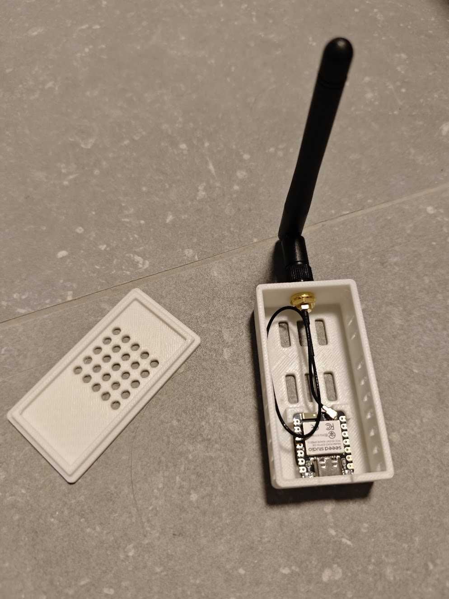

<div align="center">

# 📡 ESP32-C6 Zigbee Router

**Extend Your Zigbee Network Coverage with an Affordable ESP32-C6!**



[](https://esphome.io/components/zigbee/)
[](https://csa-iot.org/all-solutions/zigbee/)
[](https://www.home-assistant.io/)
[](https://github.com/firsttris/esp32c6-zigbee-router/actions/workflows/build.yml)
[](LICENSE)

This ESPHome configuration turns an ESP32-C6 board into a Zigbee router that seamlessly integrates with your Zigbee network to expand coverage and improve connectivity for your Zigbee devices.

---

</div>

## ✨ Features

- 📶 **Zigbee router**: extends your Zigbee mesh, no WiFi and no secrets needed
- 🧩 **Native ESPHome Zigbee**: uses the built-in [`zigbee`](https://esphome.io/components/zigbee/) component (since ESPHome 2026.5), no external component
- 🗂️ **No custom partition table**: ESPHome adds the Zigbee partition itself
- 📡 **Antenna switch** (Seeed XIAO ESP32C6): use the built-in or an external antenna
- 🔘 **Re-pair with the BOOT button**: hold it for 5 seconds to leave the network, no reflashing needed
- 💡 **Status LED**: blinks when something is wrong

## 📋 Prerequisites

| Requirement | Description |
|-------------|-------------|
| **🔧 Hardware** | ESP32-C6 board (tested with [Seeed Studio XIAO ESP32C6](https://www.seeedstudio.com/Seeed-Studio-XIAO-ESP32C6-p-5884.html)) |
| **🌐 Network** | Zigbee Coordinator in your network (e.g., Home Assistant with Zigbee2MQTT or ZHA) |
| **💻 Software** | ESPHome **2026.5 or newer** (native Zigbee component) |
| **🔌 Cable** | USB cable for initial flashing |
| **📦 Optional** | 3D-printed case - [XIAO ESP32-C6 Case](https://www.printables.com/model/1543275-xiao-esp32-c6-zigbee-router-case-split-lid-sma-ext) |

> **💡 Other boards:** The config also works on other ESP32-C6 boards. Change `board:` in `esp32-c6-zigbee-router.yaml` (e.g. `esp32-c6-devkitc-1`) and remove the block marked `Seeed XIAO ESP32C6 specific`, since it drives GPIO3, GPIO9, GPIO14 and GPIO15. ESPHome also supports Zigbee on ESP32-C5 and ESP32-H2. According to the ESPHome docs the ESP32-H2 works more reliably than the ESP32-C6, which is only tested here.

---

## 🔑 How does it work?

A Zigbee router is a **mains-powered device** that:
- ✅ Relays Zigbee signals between devices (mesh network)
- ✅ Extends the range of your Zigbee network
- ✅ Improves stability and reliability
- ✅ Connects battery-powered devices (End Devices) to the Coordinator

The router has no entities of its own. It joins your network as a Zigbee **Range Extender**.

## 🚀 Installation

### 📝 Step 1: Configure Settings (Optional)

The default configuration works right away! You can optionally customize:

**`esp32-c6-zigbee-router.yaml`:**
```yaml
substitutions:
  device_name: esp32-c6-zigbee-router  # Unique name, also used as the Zigbee model ID
  friendly_name: ESP32-C6 Zigbee Router  # Display name
```

### 📡 Step 2: Choose the Antenna (Seeed XIAO ESP32C6 only)

The XIAO ESP32C6 has a built-in ceramic antenna and a U.FL connector for an external antenna (e.g. the SMA antenna of the recommended case). The antenna is selected by an RF switch (GPIO3 = switch power, GPIO14 = antenna select).

The config uses the **external antenna** by default (`ALWAYS_ON`), matching the SMA antenna of the recommended case. If you use the **built-in antenna**, change this substitution before flashing:
```yaml
substitutions:
  antenna_mode: ALWAYS_OFF   # built-in ceramic antenna
```

> ⚠️ Without an external antenna connected, `ALWAYS_ON` gives very poor range. Switch to `ALWAYS_OFF` in that case.

You can also set it on the command line without editing the file: `esphome -s antenna_mode ALWAYS_OFF run esp32-c6-zigbee-router.yaml`

### ⚡ Step 3: Compile and Flash Firmware

Connect your ESP32-C6 via USB and flash the firmware using local ESPHome:

```bash
esphome run esp32-c6-zigbee-router.yaml --device=/dev/ttyACM0
```

> **💡 Note:** Replace `/dev/ttyACM0` with your device path (see troubleshooting below)

<details>
<summary><b>📚 Important Notes & Troubleshooting</b></summary>

### 📍 Device Paths by OS

| OS | Typical Paths |
|----|--------------|
| 🐧 Linux | `/dev/ttyUSB0`, `/dev/ttyACM0`, `/dev/ttyUSB1` |
| 🍎 macOS | `/dev/cu.usbserial-*`, `/dev/cu.usbmodem*` |
| 🪟 Windows | `COM3`, `COM4`, etc. |

**Check available ports:**
- Linux/macOS: `ls /dev/tty*`
- Windows: Device Manager

---

### 🔐 USB Permission Issues

**Standard Linux - Add user to dialout group:**
```bash
sudo usermod -a -G dialout $USER
# Then log out and back in
```

**Fedora Atomic/Bazzite with rootless Docker/Podman:**

The dialout group doesn't work reliably on immutable systems. You need to fix permissions before each flash:

```bash
# Check permissions
ls -la /dev/ttyACM0
# Output: crw-rw----. 1 root dialout 166, 0 ...

# Fix temporarily (resets on USB reconnect)
sudo chmod 666 /dev/ttyACM0

# If using Docker/Podman, restart the container
docker compose restart
```

> ⚠️ **Note:** You need to run `sudo chmod 666` each time you reconnect the USB device.

**Inside a Distrobox/Toolbox container:** the device shows up as `nobody:nogroup` and `sudo` inside the box can't change it. Run the `chmod` on the host, e.g. `distrobox-host-exec sudo chmod 666 /dev/ttyACM0`.

**SELinux (Fedora) with rootless Podman:** even with `chmod 666`, the container may get `Permission denied` on the serial port. Disable SELinux labeling for the container (`security_opt: label=disable`, already set in `docker-compose.yml`), or with `podman run`:

```bash
podman run --rm --security-opt label=disable -v "$PWD":/config \
  --device /dev/ttyACM0 ghcr.io/esphome/esphome:stable \
  run esp32-c6-zigbee-router.yaml --device /dev/ttyACM0
```

</details>

---

<details>
<summary><b>🐳 Alternative: Using Docker/Podman</b></summary>

The included `docker-compose.yml` mounts this repository as `/config` and passes the USB device into the container.

> ⚠️ **Important:** The USB device must be plugged in **before** the container starts. When using Docker/Podman (rootless), fix USB permissions first (see above).

```bash
# 1. Start container (default device: /dev/ttyACM0)
docker compose up -d
# or with another device:
ESPHOME_DEVICE=/dev/ttyUSB0 docker compose up -d

# 2. Flash the firmware
docker compose exec esphome esphome run /config/esp32-c6-zigbee-router.yaml --device=/dev/ttyACM0
```

</details>

---

<details>
<summary><b>🌐 Alternative: Web Dashboard (GUI)</b></summary>

**Docker Dashboard:**
```bash
docker compose up -d
```
The ESPHome container starts the dashboard automatically. Open **http://localhost:6052** in your browser.

> ⚠️ The dashboard has no password and listens on all interfaces (host networking). Only run it on a trusted network, or stop the container after flashing.

**Local Dashboard** (requires local ESPHome):
```bash
esphome dashboard .
```
Then open **http://localhost:6052** in your browser and use the web interface.

**Browser Flashing via [web.esphome.io](https://web.esphome.io/):**

web.esphome.io can only **flash** a finished firmware file. It cannot compile your YAML, so build it first:

1. Compile locally: `esphome compile esp32-c6-zigbee-router.yaml`
2. The firmware is written to `.esphome/build/esp32-c6-zigbee-router/build/firmware.factory.bin`
3. Open **https://web.esphome.io/** in Chrome or Edge, click "Connect", choose your ESP32-C6 and select "Install"
4. Upload the `firmware.factory.bin` file

</details>

---

### 🔗 Step 4: Connect Router to Coordinator

After flashing is complete, enable pairing mode on your Zigbee Coordinator:

**Zigbee2MQTT:**
1. Open the Zigbee2MQTT Web UI
2. Click **"Permit join (All)"** button (top right)
3. Pairing mode stays active for 4-5 minutes
4. The ESP32-C6 will automatically appear in the device list

**ZHA (Home Assistant):**
1. Go to **Settings → Devices & Services → ZHA**
2. Click **"Add Device"**
3. The ESP32-C6 will be discovered and added

> **⏱️ Note:** The device will search for and join the network automatically within 30-60 seconds after boot. Keep pairing mode active until the device appears!

> **💡 Note:** If the logs repeat `Failed to join network with status(0x03)` every few seconds, the router doesn't find a network that accepts new devices. Enable pairing mode on the coordinator. The router keeps retrying and joins within seconds.

> **❓ Why don't I see it in ESPHome?** The router has no WiFi, so it never shows up in the ESPHome dashboard (only as offline) or in the ESPHome integration of Home Assistant. You find it in Zigbee2MQTT or ZHA.

---

## ⬆️ Upgrading from an Older Version

Older versions of this repository used the external [`luar123/zigbee_esphome`](https://github.com/luar123/zigbee_esphome) component and a custom `partitions_zb.csv`. Both are gone now, ESPHome ships Zigbee natively. The Zigbee stack and the partition layout changed, so the router has to be paired again:

1. Remove the router from Zigbee2MQTT/ZHA
2. Erase the flash, so no old Zigbee data is left:
   ```bash
   esphome clean esp32-c6-zigbee-router.yaml
   esptool --port /dev/ttyACM0 erase-flash
   ```
3. Flash the new firmware and pair it again (Step 3 and 4)

---

## ✅ Verification & Testing

### 🔍 Check if Zigbee Router is working:

#### 📋 Method 1: View Logs (USB)

```bash
esphome logs esp32-c6-zigbee-router.yaml --device=/dev/ttyACM0
```

You should see:
- No continuous error messages
- First pairing: `Joined network successfully: PAN ID(...), Channel(...), Short Address(...)`
- After a reboot: `Device rebooted` and `Rejoined Zigbee network`
- In the config dump: `Router: YES`

> **💡 Note:** The config dump is printed right after boot, before the router has rejoined. It can show `Device is joined to the network: NO` even when everything works. The join messages above are what counts.

---

#### 🌐 Method 2: Check Zigbee Network

**Zigbee2MQTT:**
- Open the Zigbee2MQTT Web UI
- Go to "Map"
- The ESP32-C6 should be visible as a router
- Check the Link Quality to other devices

**ZHA (Home Assistant):**
- Go to **Settings → Devices & Services → ZHA**
- Click "Visualize"
- The ESP32-C6 should be displayed as a router

---

## 📈 Did It Actually Fix Your Dead Spot?

The Zigbee2MQTT map is a snapshot: it tells you the link quality right now, not whether the
basement sensor is better off this week than last week. [Funkloch](https://github.com/firsttris/funkloch)
(German for *dead spot*) records the signal of every Zigbee2MQTT device over days and weeks, so
you can see what your new router really changed:

- **Before and after**: the link quality of the devices around the ESP32-C6 as a history, not a
  single number.
- **Who routes through it**: the network map shows which devices picked the router as their parent.
- **Placement check**: move the router, wait a day, compare. No more guessing.
- **Early warning**: a traffic light and trend per device, and a notification (ntfy, webhook,
  MQTT) when one drops out.

One Docker container next to Zigbee2MQTT, read-only, no cloud:
[installation guide](https://firsttris.github.io/funkloch/installation.html).

---

## 🔘 Re-pair / Factory Reset

To move the router to another network, or if it doesn't rejoin:

1. Remove it from your coordinator
2. Enable pairing mode on the coordinator
3. Hold the **BOOT** button of the XIAO ESP32C6 for **5 seconds** and release it

The router leaves the network, clears its Zigbee data and pairs again. Your ESPHome config is not touched.

> **💡 Note:** Don't hold BOOT while plugging in USB, that starts the ROM bootloader instead.

---

## ⚙️ Advanced Options

### 🌡️ Chip Temperature over Zigbee

The native component can expose ESPHome sensors to your coordinator. Uncomment the `sensor:` block in `esp32-c6-zigbee-router.yaml` to get the chip temperature in Zigbee2MQTT/ZHA. After adding or removing sensors, remove the router from your coordinator and pair it again (Zigbee2MQTT: also re-interview it). Use Zigbee2MQTT **2.8.0 or newer**.

### 📶 WiFi (not recommended)

WiFi is **not needed**. The ESP32-C6 has only one radio for WiFi and Zigbee. While WiFi is active, the router misses Zigbee packets and can destabilize your mesh. ESPHome warns about this when compiling. A WiFi access point (`ap:`) is not supported at all.

If you want OTA updates via WiFi anyway, uncomment the `wifi:` and `ota:` blocks and only keep WiFi on for short periods.

---

## 🔄 Multiple Zigbee Routers

To flash multiple ESP32-C6 devices and use them as separate routers in the same Zigbee network, create a small file per additional device (e.g. `esp32-c6-zigbee-router-2.yaml`) that reuses the main config:

```yaml
substitutions:
  device_name: esp32-c6-zigbee-router-2    # Must be unique!
  friendly_name: ESP32-C6 Zigbee Router 2
  # antenna_mode: ALWAYS_OFF               # Optional: built-in antenna

packages:
  base: !include esp32-c6-zigbee-router.yaml
```

Then flash it:
```bash
esphome run esp32-c6-zigbee-router-2.yaml --device=/dev/ttyACM0
```

Each device joins the same Zigbee network and acts as an independent router, extending your mesh coverage.

---

## 📂 File Structure

```
.
├── esp32-c6-zigbee-router.yaml     # Main ESPHome configuration
├── esp32-c6-zigbee-router-2.yaml   # Optional: Second router
├── .github/workflows/build.yml     # CI: validates and compiles the config
├── .gitignore                      # Excludes secrets and build artifacts
├── docker-compose.yml              # Docker/Podman setup for ESPHome
├── LICENSE                         # MIT license
└── README.md                       # This file
```

---

## 📚 Further Resources

| Resource | Description |
|----------|-------------|
| 📖 [ESPHome Zigbee Component](https://esphome.io/components/zigbee/) | Native Zigbee component used by this config |
| 🏠 [Home Assistant Zigbee Integration](https://www.home-assistant.io/integrations/zha/) | How Zigbee works in Home Assistant |
| 📡 [Zigbee2MQTT](https://www.zigbee2mqtt.io/) | Alternative Zigbee bridge |
| 🧵 [ESP32-C6 Thread Router](https://github.com/firsttris/esp32c6-thread-router) | The same board as a Thread router |
| 📈 [Funkloch](https://github.com/firsttris/funkloch) | Signal history, network map and alerts for Zigbee2MQTT and Thread devices |

---

<div align="center">

⭐ Like the ESP32-C6 Zigbee Router? A [star on GitHub](https://github.com/firsttris/esp32c6-zigbee-router) helps others find it.<br>
🐛 [Report a bug](https://github.com/firsttris/esp32c6-zigbee-router/issues/new) · 💡 [Request a feature](https://github.com/firsttris/esp32c6-zigbee-router/issues/new)

<sub>License: <a href="LICENSE">MIT</a> · © Tristan Teufel and contributors</sub>

</div>
